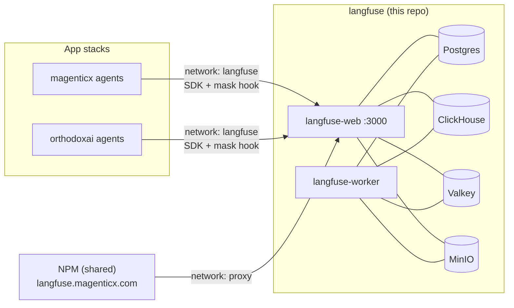

# langfuse

Self-hosted [Langfuse](https://langfuse.com) v4 for the apps on **Dennis** (a
shared ARM64 VM): full agent traceability (prompts, responses, tool I/O) for
**mAgenticX** and **OrthodoxAI**, each as its own Langfuse project. The Grafana
stack (repo `monitoring`) owns metrics, logs and SLOs; Langfuse owns what the
agents did.

This repo is configuration only — no image of its own.



| Service | Image (pinned by digest) | Memory limit |
| --- | --- | --- |
| langfuse-web | `langfuse/langfuse:4.70.0` | 1536 MiB |
| langfuse-worker | `langfuse/langfuse-worker:4.70.0` | 768 MiB |
| clickhouse | `clickhouse/clickhouse-server:26.3.60.2-alpine` (LTS; v4 needs ≥ 25.12) | 1024 MiB |
| postgres | `postgres:17.10-alpine3.24` | 256 MiB |
| valkey | `valkey/valkey:8.1.10-alpine3.24` | 128 MiB |
| minio | `cgr.dev/chainguard/minio` (RELEASE.2026-10-23) | 256 MiB |
| minio-init, retention-init | one-shots (bucket, lifecycle, least-privileged user; 30-day TTL) | — |

## Run locally

```sh
scripts/gen-secrets.sh ./secrets you@example.com   # once; files are gitignored
docker compose up -d                               # ~2 min on first boot (migrations)
docker compose ps                                  # all healthy, both one-shots Exited (0)
```

UI: <http://localhost:3300> — sign in with the e-mail you passed and the
password in `secrets/init_user_password`. Project `magenticx` and its API keys
(`secrets/init_project_*_key`) exist on first boot. Sign-up is disabled.

End-to-end check (sends a trace through the masking hook and reads it back
through the v2 Observations API):

```sh
pip install "langfuse==4.18.0"
python ci/smoke_trace.py
```

## Policies

- **Retention: 30 days** for trace content (ClickHouse TTL on `events_full`,
  `events_core`, traces, observations, scores and the topic tables; MinIO
  lifecycle on the raw ingestion events).
  Langfuse's own per-project retention is an Enterprise feature on self-hosted
  instances, so it is enforced in the storage instead.
- **Masking is the apps' job**, before data leaves them — see
  [docs/app-integration.md](docs/app-integration.md).
- **No secrets in the repo**; every secret is a file (see [SECURITY.md](SECURITY.md)).
- **Logs** are JSON where the component supports it (Langfuse, ClickHouse,
  MinIO); Postgres and Valkey log plain text at warning level.

## Repository layout

| Path | What |
| --- | --- |
| `docker-compose.yaml` / `docker-compose-denis.yaml` | Local / production stack (kept in lockstep by CI) |
| `config/clickhouse/` | Low-memory server config, JSON logs, system logs off; query limits |
| `config/minio/` | 30-day lifecycle rule; bucket-scoped policy for the `langfuse` user |
| `scripts/gen-secrets.sh` | Creates every secret file (and, on the host, sets per-uid ownership) |
| `scripts/secrets-env.sh` | Entrypoint shim: `*_FILE` → environment, for Langfuse only |
| `scripts/minio-init.sh`, `scripts/clickhouse-retention.sh` | Idempotent one-shots |
| `ci/check_config.py`, `ci/smoke_trace.py` | Policy checks; end-to-end trace test |
| `deploy/dennis-deploy.sh` | Forced-command deploy script on the host |
| `docs/app-integration.md` | How apps connect, mask and link traces |

Deployment to Dennis is automated by [`.github/workflows/pipeline.yml`](.github/workflows/pipeline.yml)
(validate → Trivy → smoke → owner-only deploy over a locked-down SSH key); the
operational runbook is kept privately.

## License

[MIT](LICENSE). Langfuse, ClickHouse, Postgres, Valkey and MinIO are used as
upstream images under their own licenses.
